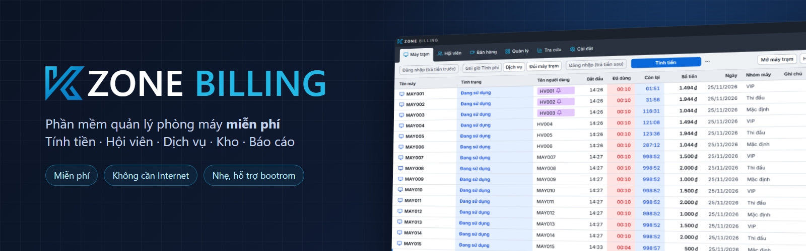
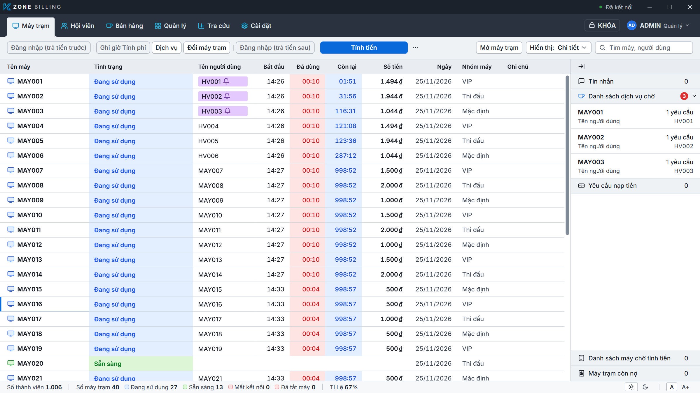
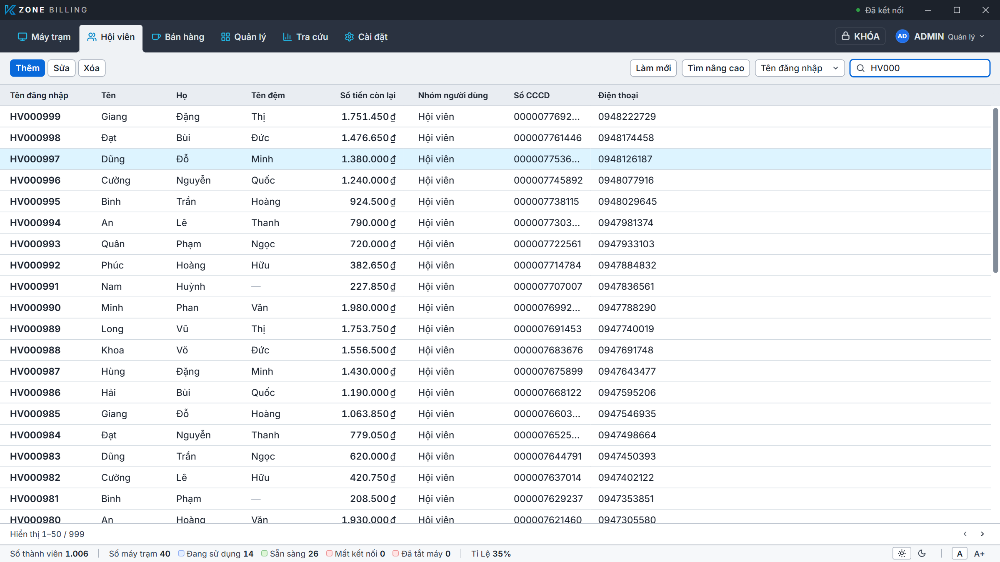
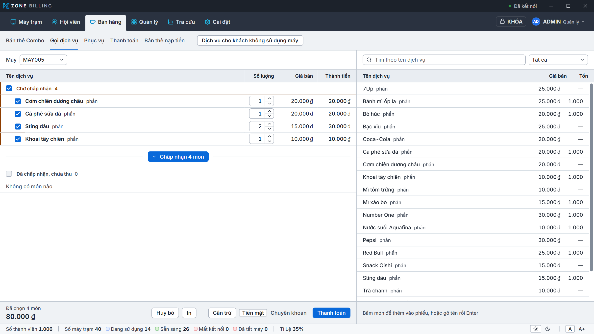
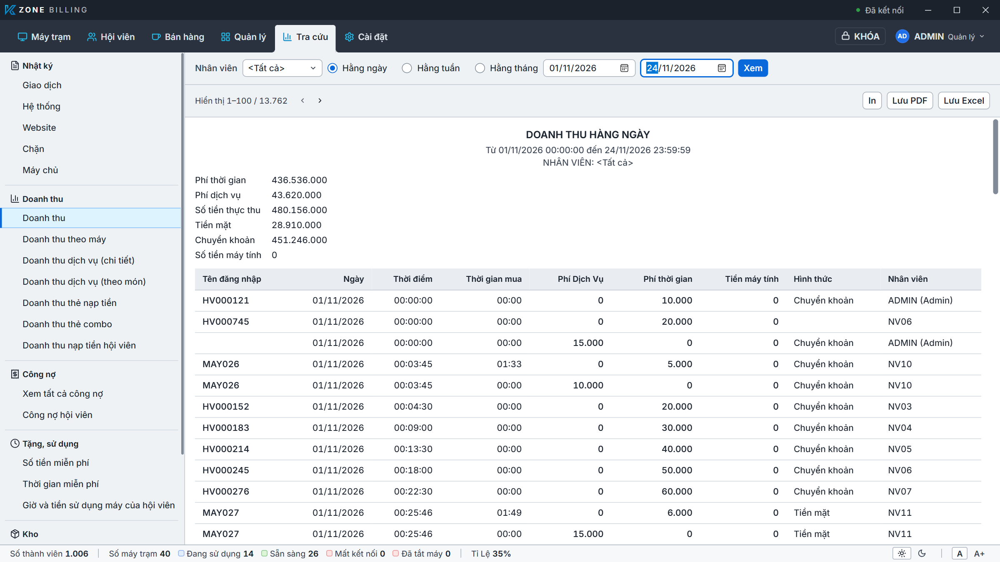
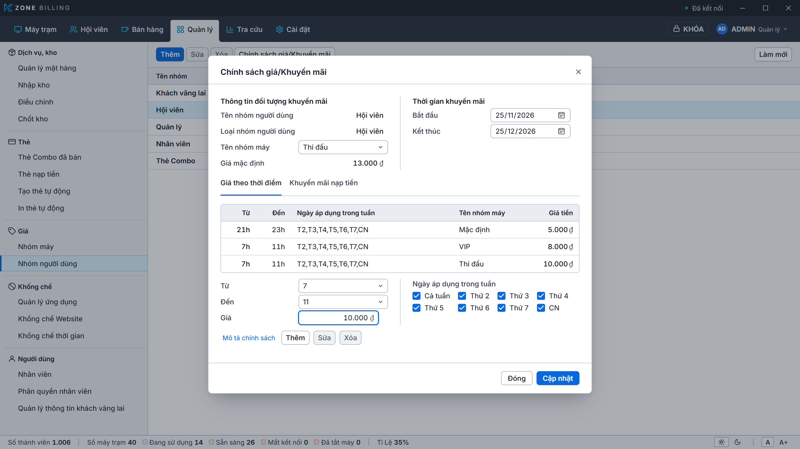

<p align="center">
  
</p>

<h1 align="center">Kzone Billing</h1>

<p align="center">
  <b>Phần mềm quản lý phòng máy miễn phí</b>: tính tiền, hội viên, dịch vụ, kho, thẻ, khống chế máy trạm, báo cáo.
</p>

<table align="center">
  <tr><td>✅ <b>Miễn phí hoàn toàn</b></td><td>Không có bản trả phí, không giới hạn số máy, số quán, không quảng cáo</td></tr>
  <tr><td>✅ <b>Không cần đăng ký</b></td><td>Không tạo tài khoản, không mã kích hoạt, không khóa bản quyền theo máy: tải về, cài đặt là dùng</td></tr>
  <tr><td>✅ <b>Không máy chủ quản lý</b></td><td>Kzone không vận hành máy chủ nào cho phần mềm; quán của bạn không phụ thuộc vào ai để hoạt động</td></tr>
  <tr><td>✅ <b>Không cloud</b></td><td>Toàn bộ dữ liệu nằm trên máy quầy của quán, được mã hóa</td></tr>
  <tr><td>✅ <b>Không thu thập dữ liệu</b></td><td>Không gửi doanh thu, thông tin hội viên, số liệu sử dụng hay bất kỳ dữ liệu nào ra ngoài</td></tr>
  <tr><td>✅ <b>Offline 100%</b></td><td>Chạy hoàn toàn trong mạng LAN của quán; mất Internet vẫn tính tiền và vận hành bình thường</td></tr>
</table>

<p align="center">
  <a href="../../releases/latest"><b>⬇ Tải bản mới nhất</b></a> ·
  <a href="#cài-đặt-nhanh">Cài đặt</a> ·
  <a href="#nhập-hội-viên-hàng-loạt">Nhập hội viên</a> ·
  <a href="#hướng-dẫn-sử-dụng">Hướng dẫn</a> ·
  <a href="#câu-hỏi-thường-gặp">Hỏi đáp</a> ·
  <a href="EULA.md">Điều khoản sử dụng</a>
</p>

---

## Giới thiệu

Kzone Billing giúp chủ phòng máy điều hành cả quán từ một máy quầy: mở máy cho khách, tính tiền giờ chơi, quản lý hội viên và tiền trong tài khoản, bán đồ ăn uống, theo dõi kho, bán thẻ nạp và Thẻ Combo, khống chế ứng dụng và website, điều khiển máy trạm từ xa, xem báo cáo doanh thu.

Cách làm việc quen thuộc với người đã từng quản lý phòng máy, nên nhân viên làm được ngay. Giao diện hiện đại, gọn gàng, ưu tiên các thao tác làm hằng ngày ở quầy.

<p align="center">
  
  <br><sub>Màn hình quầy: danh sách máy trạm</sub>
</p>

## Tính năng chính

**Tính tiền**
- Khách vãng lai trả tiền sau hoặc trả tiền trước; đang chơi trả sau vẫn chuyển sang trả trước được.
- Hội viên tự đăng nhập tại máy trạm, tiền trừ dần vào tài khoản.
- Giá theo nhóm máy, nhóm người dùng và khung giờ; khuyến mãi theo giờ, theo ngày trong tuần; đặt giá tối thiểu và cách làm tròn tiền.
- Ghi thêm giờ có tính phí hoặc miễn phí, cho hội viên mượn tiền, đổi máy, chuyển phí sang máy khác.
- Mất điện, tắt ngang màn hình quầy hay khởi động lại máy chủ đều không làm sai tiền của khách.

**Hội viên**
- Tạo, sửa hội viên; nạp tiền, tặng tiền, chuyển tiền giữa các hội viên, thu nợ.
- Tạo tài khoản hàng loạt và in thẻ.
- Nhập hội viên và số dư hàng loạt từ tệp danh sách.

**Dịch vụ, kho, thẻ**
- Khách gọi món ngay trên máy trạm; quầy nhận đơn, phục vụ và thu tiền.
- Danh mục mặt hàng, quy đổi đơn vị, nhập kho, điều chỉnh, chốt kho, cảnh báo sắp hết hàng.
- Thẻ nạp tiền, Thẻ Combo (gói giờ chơi bán trọn gói).

**Điều khiển máy trạm**
- Bật máy từ xa (Wake-on-LAN), tắt máy, khởi động lại, khóa máy, hẹn giờ tắt máy.
- Nhắn tin với khách, chụp màn hình, xem và điều khiển máy trạm từ xa, gửi tệp.
- Nâng cấp phần mềm máy trạm ngay từ quầy, không phải đi từng máy.

**Khống chế**
- Chặn ứng dụng, chặn website; giới hạn giờ chơi theo khung giờ và độ tuổi; chặn các chức năng hệ thống của Windows trên máy trạm.

**Báo cáo và an toàn dữ liệu**
- Nhật ký giao dịch, nhật ký hệ thống, lịch sử website; báo cáo doanh thu theo ngày, theo ca, theo máy, theo dịch vụ, thẻ, công nợ, kho; in hoặc xuất ra Excel.
- Phân quyền chi tiết cho từng nhân viên.
- Dữ liệu được mã hóa; sao lưu bằng tay hoặc tự động theo lịch, khôi phục ngay trên quầy.

**Nhẹ, dễ triển khai**
- Không phải cài .NET hay thư viện Visual C++; chạy tốt trên máy trạm khởi động qua mạng (bootrom).
- Không cần Internet, không có máy chủ trung tâm: dữ liệu ở lại trong quán của bạn.

## Hình ảnh

| | |
|---|---|
| <br><sub>Quản lý hội viên</sub> | <br><sub>Gọi món cho máy trạm</sub> |
| <br><sub>Báo cáo doanh thu</sub> | <br><sub>Giá theo nhóm máy và khung giờ</sub> |

## Yêu cầu hệ thống

| | Máy chủ (máy quầy) | Máy trạm |
|---|---|---|
| Hệ điều hành | Windows 10 hoặc 11, 64-bit | Windows 10 hoặc 11, 64-bit |
| Màn hình | Tối thiểu 1600 × 900 | — |
| Mạng | Cùng mạng LAN với máy trạm, nên đặt IP tĩnh | Cùng mạng LAN với máy chủ |
| Thành phần cần có | Microsoft Edge WebView2 Runtime (bộ cài tự cài nếu máy chưa có) | Microsoft Edge WebView2 Runtime (bộ cài tự cài nếu máy chưa có) |

## Cài đặt nhanh

1. Vào trang [**Releases**](../../releases/latest) và tải về:
   - `KzoneBillingServer-Setup-<phiên bản>.exe`: cài trên máy quầy;
   - `KzoneBillingClient-Setup-<phiên bản>.exe`: cài trên máy trạm.
2. **Máy quầy**: chạy bộ cài máy chủ. Lần đầu mở, quầy yêu cầu tạo tài khoản **Người Quản Lý**. Hãy ghi lại mật khẩu này.
3. **Máy trạm**: chạy bộ cài máy trạm và nhập địa chỉ IP của máy quầy. Nếu quán dùng bootrom, cài vào image gốc rồi lưu image lại.
4. Máy trạm hiện màn hình khóa và xuất hiện trong danh sách máy ở quầy. Thiết lập nhóm máy, bảng giá, nhân viên là có thể bắt đầu kinh doanh.

> [!IMPORTANT]
> Chỉ tải Kzone Billing từ trang [Releases](../../releases) chính thức này. Kzone Billing **miễn phí**: nếu có ai bán phần mềm này cho bạn, đó là lừa đảo. Bản tải từ nơi khác có thể đã bị cài mã độc.

## Nhập hội viên hàng loạt

Nếu bạn đã có sẵn danh sách hội viên kèm số dư, có thể nhập một lần vào Kzone Billing thay vì tạo từng người trên quầy. Khách đến chơi tiếp mà không mất tiền trong tài khoản.

**Lưu ý trước khi nhập**

- Chỉ nhập **tên đăng nhập và số dư**. Họ tên, số điện thoại và các thông tin khác có thể bổ sung sau trên quầy.
- **Mọi hội viên được nhập đều có mật khẩu là `1`**. Hãy nhắc khách đổi mật khẩu ở lần đăng nhập đầu tiên.
- Số dư nhập vào là tiền khách đã trả từ trước, nên **không tính vào doanh thu** của Kzone Billing.

**Bước 1: Chuẩn bị tệp danh sách hội viên**

Tạo một tệp văn bản, mỗi dòng một hội viên theo dạng `tên đăng nhập - số dư`. Số dư là số đồng, chỉ gồm chữ số, không có dấu chấm, dấu phẩy:

```text
NGUYENVANAN - 150000
tranthibinh - 0
GAMER_PRO - 2500000
```

- Lưu tệp ở dạng **UTF-8**. Với Notepad: chọn *File › Save As*, ở ô *Encoding* chọn *UTF-8*. Lưu dạng khác thì tên có dấu sẽ bị lỗi, và lệnh nhập sẽ từ chối tệp.
- Tên đăng nhập được tự đổi sang chữ in hoa, như khi tạo hội viên trên quầy.
- Có thể soạn danh sách bằng Excel: một cột tên, một cột số dư, ghép lại bằng công thức `=A1&" - "&B1`, rồi chép sang Notepad để lưu.

**Bước 2: Sao lưu dữ liệu**

Nếu đã dùng Kzone Billing một thời gian, hãy sao lưu trước trên quầy: *Cài đặt › Dữ liệu › Sao lưu và khôi phục › Lưu dự phòng cơ sở dữ liệu*.

**Bước 3: Dừng dịch vụ, nhập hội viên, chạy lại dịch vụ**

Trên máy quầy, mở **Command Prompt bằng quyền Administrator** (*Run as administrator*) rồi chạy lần lượt:

```bat
sc stop KzoneBillingService
cd /d "C:\Program Files\Kzone Billing Server"
KzoneBillingService.exe db import-members "D:\hoi-vien.txt"
sc start KzoneBillingService
```

Thay `D:\hoi-vien.txt` bằng đường dẫn tệp của bạn. Muốn đưa hội viên vào một nhóm hội viên khác nhóm mặc định "Hội viên", ghi thêm tên nhóm ở cuối lệnh, ví dụ: `KzoneBillingService.exe db import-members "D:\hoi-vien.txt" "Hội viên VIP"`.

**Kết quả**

- Lệnh kiểm tra toàn bộ tệp trước khi ghi. Có dòng sai thì lệnh báo số dòng và lý do, **không nhập hội viên nào**; sửa tệp rồi chạy lại.
- Tên đã có trong Kzone Billing, hoặc lặp lại trong tệp, sẽ được bỏ qua: không ghi đè, không cộng dồn tiền. Vì vậy chạy lại cùng một tệp không làm tiền bị nhân đôi.
- Xong lệnh, màn hình hiện số hội viên đã nhập, tổng số dư và các tên bị bỏ qua. Việc nhập cũng được ghi vào *Nhật ký máy chủ*.

## Hướng dẫn sử dụng

Tài liệu hướng dẫn đầy đủ cho chủ phòng máy (PDF) được đính kèm ở mỗi bản phát hành trên trang [Releases](../../releases/latest). Tài liệu gồm: cài đặt, thiết lập giá, vận hành quầy, hội viên, dịch vụ, kho, thẻ, khống chế, báo cáo và sao lưu.

## Câu hỏi thường gặp

<details>
<summary><b>Kzone Billing có thật sự miễn phí không?</b></summary>

Có. Bạn được dùng miễn phí cho việc kinh doanh, không giới hạn số máy, số quán. Không có bản trả phí, không có quảng cáo. Xem [Điều khoản sử dụng](EULA.md).
</details>

<details>
<summary><b>Có cần Internet không? Dữ liệu của tôi có bị gửi đi đâu không?</b></summary>

Không cần Internet. Phần mềm chạy hoàn toàn trong mạng nội bộ của quán. Kzone không có máy chủ trung tâm và không nhận bất kỳ dữ liệu nào của bạn.

Nếu máy quầy có Internet, phần mềm chỉ dùng cho hai việc phụ và không gửi dữ liệu của quán đi đâu: lấy giờ chuẩn từ máy chủ thời gian công cộng để đồng hồ máy quầy luôn đúng, và tải danh sách website cần chặn nếu bạn tự đặt địa chỉ nguồn. Không có Internet thì phần mềm bỏ qua hai việc này.
</details>

<details>
<summary><b>Mất điện giữa chừng thì tiền của khách có bị sai không?</b></summary>

Không. Thời gian chơi được ghi liên tục trên máy chủ. Khi có điện lại, phiên chơi của từng máy được khôi phục và tiếp tục tính đúng.
</details>

<details>
<summary><b>Máy trạm không hiện trên quầy?</b></summary>

Kiểm tra máy trạm và máy quầy có cùng mạng LAN không, địa chỉ IP máy quầy nhập ở máy trạm có đúng không, và cổng TCP 25250 trên máy quầy có bị chặn không. Bộ cài máy chủ đã tự mở cổng này trên Windows Firewall; nếu bạn dùng phần mềm tường lửa khác, hãy mở cổng này.
</details>

<details>
<summary><b>Quên mật khẩu Người Quản Lý?</b></summary>

Tải công cụ đặt lại mật khẩu ở trang Releases và chạy trên máy quầy. Cách làm chi tiết có trong tài liệu hướng dẫn sử dụng.
</details>

<details>
<summary><b>Windows hoặc phần mềm diệt virus cảnh báo khi cài?</b></summary>

Kzone Billing có các chức năng như khóa máy, chặn ứng dụng, điều khiển từ xa, nên đôi khi bị phần mềm diệt virus nhận nhầm là nguy hiểm. Hãy chắc chắn bạn tải từ trang Releases chính thức, rồi thêm thư mục cài đặt vào danh sách loại trừ của phần mềm diệt virus nếu cần.
</details>

## Hỗ trợ

Kzone Billing được phát hành miễn phí, không nhằm mục đích thương mại, nên **không có dịch vụ hỗ trợ kỹ thuật**: không cam kết trả lời câu hỏi, sửa lỗi hay hỗ trợ cài đặt, vận hành. Hãy đọc tài liệu hướng dẫn sử dụng và phần Câu hỏi thường gặp ở trên.

Nếu gặp lỗi, bạn có thể báo ở [Issues](../../issues); báo lỗi được ghi nhận nhưng không cam kết phản hồi. **Không đăng** mật khẩu, ảnh có thông tin hội viên hay dữ liệu kinh doanh của quán.

## Giấy phép

Kzone Billing là **phần mềm miễn phí (freeware), không công bố mã nguồn**. Việc sử dụng tuân theo [Thỏa thuận cấp phép người dùng cuối (EULA)](EULA.md). Thông tin về thành phần của bên thứ ba: [THIRD-PARTY-NOTICES.md](THIRD-PARTY-NOTICES.md).

© Kzone. Mọi quyền được bảo lưu.
